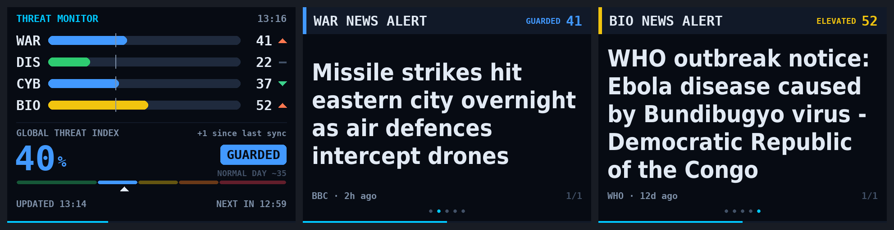

# Threat Monitor

Created and maintained by **Oliver Kuy** ([@kuydigital](https://github.com/kuydigital)).

**Website:** [kuydigital.github.io/threat_monitor](https://kuydigital.github.io/threat_monitor/)

A small dashboard that turns public news and alert feeds into a **Global Threat
Index** plus four scores: **WAR**, **DIS** (natural disasters), **CYB** (cyber)
and **BIO** (outbreaks), with the latest headline for each. It runs as a
**Windows 10/11 screensaver**, a **macOS screensaver**, a **Raspberry Pi OS / Linux
screensaver**, on a Raspberry Pi with a tiny 320×240 screen, or in a window on
any desktop.



[](https://www.youtube.com/channel/UCy69yovgkXPAzZ92min4p_g/live)
[](https://www.paypal.com/paypalme/thekuys)

## Download

| Installer | For | Download |
|---|---|---|
| **Windows screensaver** | Windows 10 and 11 | [](https://github.com/kuydigital/threat_monitor/releases/latest/download/ThreatMonitor-Windows.zip) |
| **macOS screensaver** | macOS 12 Monterey or later, Apple silicon and Intel | [](https://github.com/kuydigital/threat_monitor/releases/latest/download/ThreatMonitor-macOS.zip) |
| **Raspberry Pi OS screensaver** | Raspberry Pi OS with desktop (and other Debian-based Linux) | [](https://raw.githubusercontent.com/kuydigital/threat_monitor/main/linux/install.sh) |

All three are free. The Windows and macOS screensavers need nothing else
installed; on the [Releases](https://github.com/kuydigital/threat_monitor/releases)
page they are labeled **Windows screensaver (ZIP)** and **macOS screensaver (ZIP)**.
The Raspberry Pi OS installer is one command (it adds what it needs; see
[below](#raspberry-pi-os--linux-screensaver)):

```bash
curl -fsSL https://raw.githubusercontent.com/kuydigital/threat_monitor/main/linux/install.sh | sudo bash
```

## Windows screensaver

1. Download the **Windows screensaver (ZIP)** and unzip it.
2. Double-click **install.bat**. If Windows shows *"Windows protected your PC"*,
   click *More info → Run anyway* (shown for downloaded programs that aren't
   signed by a company).
3. Screen Saver Settings opens with **ThreatMonitor** selected. Pick a wait
   time and click **OK**.

To remove it, run `uninstall_screensaver.bat`.

**Building it yourself:** double-click `build_screensaver.bat` in a copy of
this repository. It builds the screensaver and installs it. If Python isn't
installed, it offers to install Python 3.13 for your user account first (no
admin rights needed). The finished screensaver carries its own copy of
Python, so Python is only needed for building.

## macOS screensaver

1. Download the **macOS screensaver (ZIP)** and open it.
2. Double-click **Threat Monitor.saver** and click **Install**.
3. If macOS says it can't verify *Threat Monitor.saver* (when installing or
   when you first pick it), click *Done*, open **System Settings → Privacy &
   Security**, scroll down and click **Open Anyway**. macOS asks this once for
   free apps that aren't registered with Apple.
4. In **System Settings → Screen Saver**, pick **Threat Monitor**.

Or install it from Terminal, with no security prompts:

```bash
curl -fsSL https://raw.githubusercontent.com/kuydigital/threat_monitor/main/mac/install.sh | bash
```

To remove it, Control-click Threat Monitor in the Screen Saver settings and
choose *Delete*, or delete it from `~/Library/Screen Savers`. After installing
a newer version, log out and back in if the old one still shows.

The Mac screensaver is a native Swift program (in [`mac/`](mac)) with the same
sources, scoring and screens as the Python version; its tests check that both
give identical results on the same news. **Building it yourself:** run
`mac/build.sh` on a Mac with Xcode or the Command Line Tools
(`xcode-select --install`), then double-click `mac/build/Threat Monitor.saver`.

## Raspberry Pi OS / Linux screensaver

For Raspberry Pi OS with a desktop (and other Debian-based Linux). In a
terminal:

```bash
curl -fsSL https://raw.githubusercontent.com/kuydigital/threat_monitor/main/linux/install.sh | sudo bash
```

Or from a copy of this repository: `sudo linux/install.sh`.

The installer:
- adds what it needs (`python3-pygame`, `python3-requests`, `xprintidle`);
- puts the Threat Monitor in `/opt/threat-monitor`;
- checks that every screen draws correctly;
- starts it at every desktop login.

After 5 idle minutes the Threat Monitor appears full screen, and any key, click
or mouse move closes it. After 60 idle minutes the screen switches off. To try
it straight away, run `threat-monitor-screensaver preview` from a terminal on
the desktop.

- **Settings:** change the minutes in `/etc/threat-monitor-screensaver.conf`.
  Changes apply at the next login.
- **Running it again** updates it and keeps your settings.
- **To remove it:** run `sudo /opt/threat-monitor/uninstall.sh`.

**How it behaves:**
- It never appears over a full-screen app, such as a film, or the Threat
  Monitor already running full screen on a Pi's own little screen.
- It skips VNC virtual desktops unless you set `INCLUDE_VNC=yes`.
- Like the other screensavers, it doesn't dim at night.

**Where things are kept:** saved scores and the log go in
`~/.local/share/threat-monitor`.

**Desktops:** it's tested on the X11 desktop (LXDE / openbox). On Wayland
(labwc / wayfire) it uses `swayidle`.

## Raspberry Pi / Linux / macOS (Python)

```bash
sudo apt install python3-pygame python3-requests   # Raspberry Pi OS / Debian
# or: pip install -r requirements.txt

python3 threat_monitor.py                     # full screen
python3 threat_monitor.py --windowed 320x240  # in a window
python3 threat_monitor.py --demo              # sample data, no network
python3 threat_monitor.py --check             # test every source, explain the scores
python3 threat_monitor.py --no-dim            # stay at full brightness at night
```

Keys: **Esc/Q** quit · **→ / Space / tap** next screen · **←** previous ·
**R** update now · **F** switch between window and full screen.

The screen dims to 15% brightness from 12 midnight to 6 AM, using the Pi's
own clock (set its timezone with `sudo raspi-config` → Localisation Options →
Timezone). To change the hours or the night brightness, edit `NIGHT_HOURS` and
`NIGHT_BRIGHTNESS` near the top of `threat_monitor.py`. The Windows and macOS
screensavers don't dim.

## How the scores work

- **WAR, CYB, BIO** (since v1.4.0) start from an official rating and the
  news can move it by up to **15 points** either way:
  - **WAR:** [INFORM Severity](https://drmkc.jrc.ec.europa.eu/inform-index/INFORM-Severity)
    (EU JRC, UN OCHA and ACAPS, monthly). This is the number of conflict
    crises rated *Very High*, compared with INFORM's own record since
    September 2020: a typical month (17) reads about 35, the worst so far
    (21) about 73.
  - **CYB:** [CISA](https://www.cisa.gov). Each actively exploited
    vulnerability added in the last 7 days counts 1 point (2 if ransomware
    uses it), and each joint cybersecurity advisory of the last 14 days
    counts 4.
  - **BIO:** [CDC travel health notices](https://wwwnc.cdc.gov/travel/notices).
    Level 4 counts 15 points, Level 3 counts 6, and Levels 1–2 count up to
    5 together. Add 15 while a WHO outbreak notice of the last 30 days names
    a public health emergency of international concern (PHEIC).
  - CYB and BIO points go on the same curve as DIS: 100 × (1 − e^(−points/20)).
  - **News pulse:** how much of the general news is about the threat,
    compared with each source's usual level over the last 30 days. News at
    its usual level adds nothing; at most it adds or removes 15 points. The
    first day uses starting estimates while the monitor learns what "usual"
    looks like (shown as *LEARNING n/24h*).
  - If an official source can't be reached, the category falls back to the
    news alone, as it did before v1.4.0.
- **DIS** uses official GDACS alert levels (USGS earthquake alerts as a backup):
  routine green alerts count a little, orange and red alerts count fully.
- **Global Threat Index** combines the four, giving more weight to whichever
  is highest.
- Levels: LOW < 30 · GUARDED 30–44 · ELEVATED 45–59 · HIGH 60–74 · SEVERE 75+.

The official ratings come from the agencies that track each threat; the news
only nudges them. It is still an indicator, not a forecast.

## Data sources

[BBC News](https://www.bbc.co.uk/news), [Al Jazeera](https://www.aljazeera.com),
[NPR](https://www.npr.org) and [Google News](https://news.google.com) RSS feeds;
[GDACS](https://www.gdacs.org) disaster alerts (© European Union, CC BY 4.0);
[USGS](https://earthquake.usgs.gov) earthquake feed;
[CISA Known Exploited Vulnerabilities](https://www.cisa.gov/known-exploited-vulnerabilities-catalog)
and [cybersecurity advisories](https://www.cisa.gov/news-events/cybersecurity-advisories);
[WHO Disease Outbreak News](https://www.who.int/emergencies/disease-outbreak-news);
[CDC travel health notices](https://wwwnc.cdc.gov/travel/notices);
[INFORM Severity Index](https://drmkc.jrc.ec.europa.eu/inform-index/INFORM-Severity)
(INFORM, a collaboration of the IASC Reference Group on Risk, Early Warning and
Preparedness and the European Commission; CC BY 4.0).
Headlines belong to their publishers and are shown with their source.

## Troubleshooting

- **Windows:** the log is `%APPDATA%\ThreatMonitor\screensaver.log`. If
  ThreatMonitor is missing from the Screen Saver list, run
  `register_screensaver.bat`.
- **macOS:** the log is `screensaver.log` in
  `~/Library/Containers/com.apple.ScreenSaver.Engine.legacyScreenSaver/Data/Library/Application Support/ThreatMonitor`.
- **Pi / Linux:** `threat_monitor.log` next to the script records every update
  and any source that failed. `python3 threat_monitor.py --check` shows what
  each source returned.
- **Linux screensaver:** the log is `~/.local/share/threat-monitor/screensaver.log`;
  start and stop messages are in `journalctl -t threat-monitor-screensaver`.

## Publishing a new release (maintainers)

On GitHub: **Releases → Draft a new release**, create a tag such as `v1.1.0`,
and click **Publish release**. Or from a terminal:

```bash
git tag v1.1.0
git push origin v1.1.0
```

Either way, GitHub Actions builds both screensavers (Windows and macOS), tests
them, and attaches **Windows screensaver (ZIP)** and **macOS screensaver (ZIP)**
to the release a few minutes later (see `.github/workflows/release.yml`). For a
tag pushed from a terminal, the release text comes from
`.github/release-notes/<tag>.md` if that file exists. The
download buttons above always point to the newest release. *Actions → Build
screensavers → Run workflow* runs the same builds and tests without
publishing anything.

## License

Released under the [MIT License](LICENSE). Copyright (c) 2026 Oliver Kuy.
